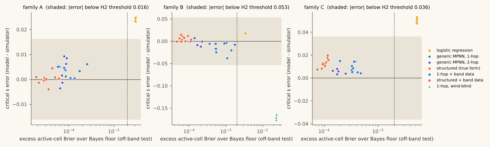

# wildfire: does a good next-step fire model find the tipping point?

**No, not by the pre-registered standard: none of the 75 trained GNN seeds was both locally excellent and off by more than the threshold with non-overlapping intervals. The largest critical-s error among locally excellent seeds was -0.038 (generic MPNN, 1-hop, family B).**

> This is a simplified, synthetic simulation. It must never inform real fire or evacuation decisions.

- Every eligible GNN seed was locally excellent: off-band excess Brier between 0.00002 and 0.00174, against a margin of 0.002. Their tipping points all landed within 0.038 of the simulator's, each inside its family's pre-registered threshold (half the 10-90% transition width: A 0.016, B 0.053, C 0.036).
- The misses are small but real: in 46 of 75 seeds the model's 95% interval for critical s did not overlap the simulator's. So the answer to "can it be off?" is yes, measurably; to "can it be off by a meaningful fraction of the transition?" it is no, at L=128 and at this margin.
- Next-step skill did not rank tipping-point skill: in family C, the structured (true form) model had the lowest excess Brier of the three default GNNs (0.00011) and the largest mean critical-s error (+0.014).
- All-cell accuracy is the wrong yardstick: the never-ignite predictor scores 99.48%-99.66% and never crosses at any s tested (up to 1.3).
- Masking matters: with no mask, the generic MPNNs' rare ignitions of cells with no burning neighbour made 88%-100% of fires at the simulator's critical s cross (about half would, masked).



This repository was designed and run autonomously by an AI agent, Claude, from a single prompt: the simulator, the experiments, the pre-registration, the analysis, this text and the demo.

A fire on a grid either dies out or crosses the map, and a small change in the base spread control s decides which. The simulator's tipping point (critical s, 50% crossing at L=128) was measured, then graph neural networks were trained on next-step data with the critical region held out, and rolled out to see where *their* tipping point lands.

| family | simulator critical s | generic 1-hop MPNN | structured model | locally excellent seeds |
|---|---|---|---|---|
| A | 0.5719 | 0.574 (+0.002) | 0.571 (-0.001) | 25/25 |
| B | 0.8112 | 0.790 (-0.021) | 0.820 (+0.009) | 25/25 |
| C | 0.7180 | 0.727 (+0.009) | 0.732 (+0.014) | 25/25 |

Hypotheses (pre-registered at commit `1c697d0338f8384833044f184ef5d878f1c96c83`): H1 supported; H2 not supported; H3 not supported; H4 inconclusive; H5 not supported. Details, intervals and limitations: [REPORT.md](REPORT.md).

## The demo

`docs/index.html` is a single static page (vanilla JS, no libraries, no build step, no network
requests, no cookies). Open it straight from disk, or serve `docs/` with GitHub Pages. Paint or
generate a landscape, set s with the slider, light the top row and watch the simulator and a trained
model burn the same landscape side by side, with the measured crossing curves underneath. The model
weights ship as JSON inside `docs/data.js`, and the JS inference is hand-written; a test checks it
matches Python within 1e-5.

## Layout

- `wildfire/` simulator, fits, models, NumPy autodiff, training, rollouts, evaluation
- `scripts/` gates, ground truth, data, training runs, analysis, figures, rendering, demo export
- `results/` every result as JSON (seed, config, git hash, date); `figures/` the plots
- `PREREGISTRATION.md` (fixed before training), `DEVIATIONS.md`, `EMBERS.md`, `REPORT.md`
- `tests/` simulator, gradients, models, JS parity, report-number checks

## Reproduce

```
uv venv .venv && uv pip install -p .venv/bin/python --require-hashes -r requirements.txt
make test
make reproduce
```

MIT licence, copyright Theo Dal Pozzo.
