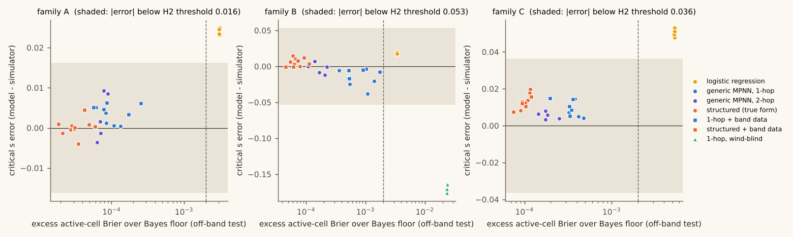
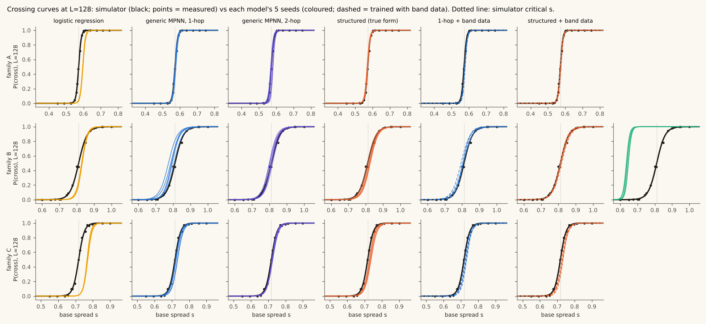
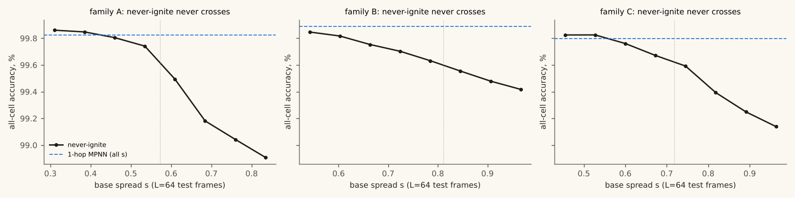
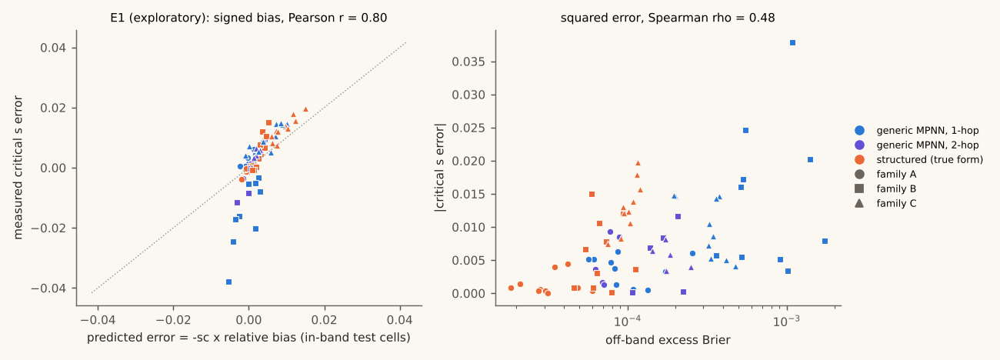

# Report: does a locally excellent learned fire model put the tipping point in the right place?

## The answer

No, not by the pre-registered standard: none of the 75 trained GNN seeds was both locally excellent and off by more than the threshold with non-overlapping intervals. The largest critical-s error among locally excellent seeds was -0.038 (generic MPNN, 1-hop, family B).

- Every eligible GNN seed was locally excellent: off-band excess Brier between 0.00002 and 0.00174, against a margin of 0.002. Their tipping points all landed within 0.038 of the simulator's, inside the pre-registered thresholds (half the 10-90% transition width: A 0.016, B 0.053, C 0.036).
- The misses are small but real: in 46 of 75 seeds the model's 95% interval for critical s did not overlap the simulator's. So the answer to "can it be off?" is yes, measurably; to "can it be off by a meaningful fraction of the transition?" it is no, at L=128 and at this margin.
- Next-step skill did not rank tipping-point skill: in family C, the structured (true form) model had the lowest excess Brier of the three default GNNs (0.00011) and the largest mean critical-s error (+0.014).
- All-cell accuracy is the wrong yardstick: the never-ignite predictor scores 99.48%-99.66% and never crosses at any s tested (up to 1.3).
- Masking matters: with no mask, the generic MPNNs' rare ignitions of cells with no burning neighbour made 88%-100% of fires at the simulator's critical s cross (about half would, masked).

Main hypothesis H2: **not supported** (0 passing seeds out of 75 tried; 75 of the 75 were locally excellent; 46 excellent seeds had a critical-s CI that did not overlap the simulator's, but an error below the size threshold). Judged per model instead (mean over 5 seeds), 0 of 15 model-family pairs pass.



This is a synthetic toy. It must never inform real fire or evacuation decisions. The study was designed and run autonomously by an AI agent (Claude) from a single prompt. Pre-registration commit: `1c697d0338f8384833044f184ef5d878f1c96c83`.

## Method

- **Simulator** (`wildfire/sim.py`): L x L grid, 4-neighbour; each burning neighbour independently ignites an unburnt fuel cell with q = clip(s x moisture x wind x slope, 0, 1); burning lasts one step; the top row is lit at step 0; a fire *crosses* if it reaches the bottom row. Vectorised over many trials, only the burning front is touched, seeded.
- **Gates** at L=128: G1 bond percolation critical s = 0.4995 (0.4986, 0.5002) (target 0.5, Kesten 1980) - pass; G2 site percolation critical p = 0.5925 (0.5918, 0.5931) (target 0.592746, Newman and Ziff 2000) - pass. Each used 400 trials at 13 and 14 control values.
- **Critical s** = the 50% point of a binomial maximum-likelihood logistic fit of crossing against s at L=128 (a finite-size value, not an infinite-lattice threshold); 95% CIs by bootstrap.
- **Families**: A uniform (iid fuel 0.9); B wind (along-wind factors 1 +/- 0.5, north/south 0.6, random east/west sign); C patchy fuel, smooth moisture, slope. Ground truth:

| family | critical s, L=128 (95% CI) | trials | critical s, L=64 (95% CI) | 10-90% width, L=128 | logistic fit p | clipped edges at critical s |
|---|---|---|---|---|---|---|
| A | 0.5719 (0.5711, 0.5729) | 4050 | 0.5709 (0.5696, 0.5725) | 0.0324 | 0.61 | 0.0% |
| B | 0.8112 (0.8083, 0.8139) | 4050 | 0.8124 (0.8081, 0.8165) | 0.1066 | 0.70 | 25.0% |
| C | 0.7180 (0.7163, 0.7199) | 4050 | 0.7206 (0.7177, 0.7236) | 0.0728 | 0.14 | 0.0% |

- **Data**: L=64 simulator rollouts. Training s excludes the band |s - sc| < 0.08 around each family's measured critical s. **That gap is centred on the known answer**, which a real modeller would not know. Fixed test set built before training, covering the band too.
- **Models** see raw fields only (s, fuel, moisture, elevation, wind vector, cell state), never q or its factors. Generic MPNNs (1-hop, 2-hop), a wind-blind 1-hop control in B, and a structured model that predicts one probability per directed edge and combines them as 1 - prod(1 - q). **The structured model has the true functional form by construction.** 5 seeds each; hidden size chosen on validation Brier only. Trained with NumPy and hand-written gradients (PyTorch could not be installed here).
- **Locally excellent** = excess active-cell Brier over the Bayes floor at most 0.002 on the off-band test set. Excess = mean (p_model - p_true)^2 over active cells, where p_true comes from the simulator's q.
- **Rollouts**: masked (only active cells may ignite) at L=128 on fresh simulator landscapes, with an adaptive pre-registered trial rule.



## Results by family

### Family A

Simulator critical s at L=128: **0.5719** (0.5711, 0.5729), 10-90% width 0.032; H2 threshold 0.0162.

| model | all-cell accuracy | active-cell Brier (off-band) | excess over floor | ECE | critical s, mean (95% t-interval) | seed range | error vs simulator | excellent seeds |
|---|---|---|---|---|---|---|---|---|
| never-ignite | 99.48% | 0.7335 | 0.5889 | 0.733 | never crosses | - | - | - |
| persistence | 98.91% | 0.7335 | 0.5889 | 0.733 | never crosses | - | - | - |
| logistic regression | 99.82% | 0.1488 | 0.00307 | 0.032 | 0.596 (0.595, 0.597) | 0.595-0.597 | +0.024 (0.023, 0.025) | 0/5 |
| generic MPNN, 1-hop | 99.82% | 0.1454 | 0.00009 | 0.003 | 0.574 (0.572, 0.577) | 0.572-0.577 | +0.002 (-0.000, 0.005) | 5/5 |
| generic MPNN, 2-hop | 99.82% | 0.1454 | 0.00007 | 0.004 | 0.575 (0.568, 0.582) | 0.568-0.581 | +0.003 (-0.004, 0.010) | 5/5 |
| structured (true form) | 99.82% | 0.1453 | 0.00003 | 0.004 | 0.571 (0.569, 0.573) | 0.568-0.572 | -0.001 (-0.003, 0.001) | 5/5 |
| 1-hop + band data | 99.82% | 0.1454 | 0.00013 | 0.004 | 0.577 (0.576, 0.579) | 0.575-0.578 | +0.005 (0.004, 0.007) | 5/5 |
| structured + band data | 99.82% | 0.1453 | 0.00004 | 0.004 | 0.573 (0.571, 0.575) | 0.572-0.576 | +0.001 (-0.001, 0.004) | 5/5 |

### Family B

Simulator critical s at L=128: **0.8112** (0.8083, 0.8139), 10-90% width 0.107; H2 threshold 0.0533.

| model | all-cell accuracy | active-cell Brier (off-band) | excess over floor | ECE | critical s, mean (95% t-interval) | seed range | error vs simulator | excellent seeds |
|---|---|---|---|---|---|---|---|---|
| never-ignite | 99.66% | 0.6855 | 0.5569 | 0.686 | never crosses | - | - | - |
| persistence | 99.30% | 0.6855 | 0.5569 | 0.686 | never crosses | - | - | - |
| logistic regression | 99.89% | 0.1383 | 0.00340 | 0.034 | 0.830 (0.828, 0.832) | 0.828-0.832 | +0.019 (0.017, 0.021) | 0/5 |
| generic MPNN, 1-hop | 99.89% | 0.1360 | 0.00078 | 0.013 | 0.790 (0.776, 0.805) | 0.773-0.805 | -0.021 (-0.035, -0.006) | 5/5 |
| generic MPNN, 2-hop | 99.89% | 0.1353 | 0.00017 | 0.009 | 0.808 (0.799, 0.818) | 0.800-0.818 | -0.003 (-0.012, 0.006) | 5/5 |
| structured (true form) | 99.89% | 0.1352 | 0.00007 | 0.009 | 0.820 (0.813, 0.827) | 0.811-0.826 | +0.009 (0.002, 0.016) | 5/5 |
| 1-hop + band data | 99.89% | 0.1360 | 0.00094 | 0.011 | 0.803 (0.797, 0.810) | 0.794-0.808 | -0.008 (-0.015, -0.001) | 5/5 |
| structured + band data | 99.89% | 0.1352 | 0.00007 | 0.010 | 0.814 (0.809, 0.818) | 0.810-0.819 | +0.003 (-0.002, 0.007) | 5/5 |
| 1-hop, wind-blind (control) | 99.88% | 0.1605 | 0.02366 | 0.018 | 0.642 (0.636, 0.648) | 0.635-0.647 | -0.169 (-0.176, -0.163) | 0/5 |

### Family C

Simulator critical s at L=128: **0.7180** (0.7163, 0.7199), 10-90% width 0.073; H2 threshold 0.0364.

| model | all-cell accuracy | active-cell Brier (off-band) | excess over floor | ECE | critical s, mean (95% t-interval) | seed range | error vs simulator | excellent seeds |
|---|---|---|---|---|---|---|---|---|
| never-ignite | 99.55% | 0.6657 | 0.4924 | 0.666 | never crosses | - | - | - |
| persistence | 99.05% | 0.6657 | 0.4924 | 0.666 | never crosses | - | - | - |
| logistic regression | 99.80% | 0.1795 | 0.00529 | 0.036 | 0.768 (0.766, 0.771) | 0.766-0.771 | +0.050 (0.048, 0.053) | 0/5 |
| generic MPNN, 1-hop | 99.80% | 0.1751 | 0.00036 | 0.004 | 0.727 (0.721, 0.734) | 0.722-0.733 | +0.009 (0.003, 0.016) | 5/5 |
| generic MPNN, 2-hop | 99.80% | 0.1750 | 0.00019 | 0.004 | 0.724 (0.721, 0.726) | 0.721-0.726 | +0.006 (0.003, 0.008) | 5/5 |
| structured (true form) | 99.80% | 0.1749 | 0.00011 | 0.004 | 0.732 (0.727, 0.738) | 0.726-0.738 | +0.014 (0.009, 0.020) | 5/5 |
| 1-hop + band data | 99.80% | 0.1751 | 0.00031 | 0.004 | 0.729 (0.724, 0.734) | 0.723-0.733 | +0.011 (0.006, 0.016) | 5/5 |
| structured + band data | 99.80% | 0.1749 | 0.00010 | 0.004 | 0.730 (0.726, 0.734) | 0.726-0.734 | +0.012 (0.008, 0.016) | 5/5 |

## Hypotheses

**H1 - best GNN beats the baselines on active-cell Brier: supported.**
- A: best GNN structured (true form), mean 0.1453 (upper 95% bound 0.1453) vs logistic regression 0.1488 (lower bound 0.1488), never-ignite 0.7335, persistence 0.7335 - supported.
- B: best GNN structured (true form), mean 0.1352 (upper 95% bound 0.1352) vs logistic regression 0.1383 (lower bound 0.1383), never-ignite 0.6855, persistence 0.6855 - supported.
- C: best GNN structured (true form), mean 0.1749 (upper 95% bound 0.1750) vs logistic regression 0.1795 (lower bound 0.1795), never-ignite 0.6657, persistence 0.6657 - supported.

**H2 - a locally excellent model misplaces the tipping point: not supported.** Judged per seed. 0 of 75 seeds pass. Seeds that were locally excellent with a CI separated from the simulator's: 46.

| family | model | seeds excellent | seeds with |error| > threshold | seeds CI-separated | seeds passing |
|---|---|---|---|---|---|
| A | generic MPNN, 1-hop | 5 | 0 | 2 | 0 |
| A | generic MPNN, 2-hop | 5 | 0 | 3 | 0 |
| A | structured (true form) | 5 | 0 | 1 | 0 |
| A | 1-hop + band data | 5 | 0 | 5 | 0 |
| A | structured + band data | 5 | 0 | 1 | 0 |
| B | generic MPNN, 1-hop | 5 | 0 | 4 | 0 |
| B | generic MPNN, 2-hop | 5 | 0 | 3 | 0 |
| B | structured (true form) | 5 | 0 | 3 | 0 |
| B | 1-hop + band data | 5 | 0 | 2 | 0 |
| B | structured + band data | 5 | 0 | 1 | 0 |
| C | generic MPNN, 1-hop | 5 | 0 | 3 | 0 |
| C | generic MPNN, 2-hop | 5 | 0 | 3 | 0 |
| C | structured (true form) | 5 | 0 | 5 | 0 |
| C | 1-hop + band data | 5 | 0 | 5 | 0 |
| C | structured + band data | 5 | 0 | 5 | 0 |

**H3 - critical-band data halves the critical-s error: not supported** (1 of 2 conclusive cells supported).
- A/mpnn1: |mean error| default 0.0022, with band 0.0051 - inconclusive (default error below the 0.01 measurement floor).
- A/structured: |mean error| default 0.0011, with band 0.0013 - inconclusive (default error below the 0.01 measurement floor).
- B/mpnn1: |mean error| default 0.0209, with band 0.0078 - supported.
- B/structured: |mean error| default 0.0089, with band 0.0026 - inconclusive (default error below the 0.01 measurement floor).
- C/mpnn1: |mean error| default 0.0092, with band 0.0107 - inconclusive (default error below the 0.01 measurement floor).
- C/structured: |mean error| default 0.0144, with band 0.0118 - not supported.

**H4 - 2-hop equivalent to 1-hop within +/- 0.02 on critical s: inconclusive.**
- A: difference (2-hop - 1-hop) +0.0007, Welch 95% CI (-0.0064, 0.0077) - supported.
- B: difference (2-hop - 1-hop) +0.0182, Welch 95% CI (0.0034, 0.0330) - inconclusive.
- C: difference (2-hop - 1-hop) -0.0036, Welch 95% CI (-0.0099, 0.0027) - supported.

**H5 - the structured model (true form by construction) has lower critical-s error than the generic 1-hop MPNN: not supported.**
- A: mean |error| generic 0.0022, structured 0.0013; difference CI (-0.0018, 0.0036) - inconclusive.
- B: mean |error| generic 0.0209, structured 0.0089; difference CI (-0.0024, 0.0265) - not supported.
- C: mean |error| generic 0.0092, structured 0.0144; difference CI (-0.0124, 0.0019) - not supported.

## Controls



- **Never-ignite, family A**: all-cell accuracy 99.48% overall (lowest by s bin 98.91%), and it never crosses. All-cell accuracy rewards predicting that nothing happens; it says nothing about the tipping point.
- **Never-ignite, family B**: all-cell accuracy 99.66% overall (lowest by s bin 99.42%), and it never crosses. All-cell accuracy rewards predicting that nothing happens; it says nothing about the tipping point.
- **Never-ignite, family C**: all-cell accuracy 99.55% overall (lowest by s bin 99.14%), and it never crosses. All-cell accuracy rewards predicting that nothing happens; it says nothing about the tipping point.
- **Oracle rollouts, family A** (true q through the model-rollout code): critical s 0.5715 (0.5703, 0.5729) vs simulator 0.5719.
- **Oracle rollouts, family B** (true q through the model-rollout code): critical s 0.8095 (0.8068, 0.8120) vs simulator 0.8112.
- **Oracle rollouts, family C** (true q through the model-rollout code): critical s 0.7166 (0.7147, 0.7188) vs simulator 0.7180.

Unmasked rollouts (seed 0, 16 fires at the simulator's critical s, at most 300 steps): rate of ignitions of cells with no burning neighbour, per non-active cell-step, and the share of those fires that crossed. Masked, about half would cross at this s. The structured model is zero by construction.

| family | logistic regression | generic MPNN, 1-hop | generic MPNN, 2-hop | structured (true form) | 1-hop + band data | structured + band data | 1-hop, wind-blind (control) |
|---|---|---|---|---|---|---|---|
| A | 9.1e-03; crossed 100% | 2.0e-05; crossed 100% | 1.6e-06; crossed 88% | 0; crossed 44% | 1.2e-05; crossed 100% | 0; crossed 31% | - |
| B | 9.1e-03; crossed 100% | 4.3e-05; crossed 100% | 3.4e-06; crossed 100% | 0; crossed 56% | 3.6e-05; crossed 100% | 0; crossed 44% | 6.0e-05; crossed 100% |
| C | 1.0e-02; crossed 100% | 2.7e-05; crossed 100% | 1.5e-06; crossed 88% | 0; crossed 25% | 2.3e-05; crossed 100% | 0; crossed 19% | - |

- **Wind-blind control (B)**: critical s 0.642 (0.636, 0.648), error -0.169; off-band excess 0.02366.

## Embers (exploratory, not confirmatory)

Hypotheses for these were written in EMBERS.md and committed before they ran. They were chosen after seeing H1-H5, so they are exploratory.

**E1 - signed bias, not squared error, tracks the tipping-point error: supported.** Across 75 GNN seeds, the error predicted from each model's mean relative bias on in-band test cells (-sc x bias) correlates with the measured critical-s error at Pearson r = 0.80 (slope 1.96), while off-band excess Brier and |error| have Spearman rho = 0.48. The slope is near the top of the stated range, so the simple rescaling argument underestimates the shift. The clearest outliers are family B's 1-hop MPNNs: under wind, errors can cancel in a mean while still distorting the direction-dependent spread.



## Limitations

- **This is not fire.** Real fire spread depends on fuel type and load, live and dead fuel moisture, wind
  that varies in time and with terrain, spotting (embers carried far ahead of the front), radiant and
  convective heating, suppression, and weather. Here a cell burns for exactly one step, spread is
  nearest-neighbour only, the wind is constant, and every factor is a made-up multiplier. The "tipping
  point" is a finite-size percolation-style transition on a 128 x 128 grid. Nothing here transfers to
  real landscapes, and it must never inform real fire or evacuation decisions.
- **Finite size.** Critical s is a finite-size, finite-grid quantity, measured at L=128 and reported at
  L=64. It is not an infinite-lattice threshold.
- **The held-out band is centred on the known answer.** A real modeller would not know where the critical
  region is. Centring the gap on it is a best case for "the model never saw the transition".
- **Small models, one architecture family.** Hidden sizes 16 or 32, fixed training budget, a
  hyperparameter grid of two values. Larger or differently trained models could behave differently.
- **Multiple comparisons.** H2 is judged per seed across many seeds and families; a single passing seed
  is a weaker claim than a per-model pass. Both views are reported.
- **The excellence margin is a choice.** 0.002 excess Brier was fixed in advance. A stricter tier (0.0005)
  is reported in the tables (excess column) so a reader can apply their own.
- **Family B clips.** A quarter of fuel-to-fuel edges at B's critical point have raw q above 1 and are
  clipped (the downwind edges). This was left as specified rather than tuned away.
- **Cited work.** Kesten (1980) proved the square-lattice bond percolation threshold is 1/2; Newman and
  Ziff (2000) estimated the site threshold 0.592746. I am confident both exist; I did not re-check them
  online, because network use was limited to package downloads.

## What I got wrong along the way

- I first tried to install PyTorch. The CPU wheel index was blocked and the CUDA build was too slow to
  download, so training is NumPy with hand-written gradients. This cost time and is recorded in
  DEVIATIONS.md.
- A timing pilot trained two models before the pre-registration was committed, so I had seen two results
  before fixing the plan. The margins had been drafted before the pilot and were not changed; this is
  disclosed in the pre-registration itself.
- My first ground-truth script derived each family's random seed from its position in the command line,
  so running one family alone would have changed its seed. Fixed before any committed result depended on it.
- See DEVIATIONS.md for every change of plan after the pre-registration.

## Reproduce

```
uv venv .venv && uv pip install -p .venv/bin/python --require-hashes -r requirements.txt
make test        # pytest + ruff, includes the JS/Python parity test (needs node)
make reproduce   # small version of every figure into repro_out/, under 10 minutes
make full        # everything, several hours on 4 vCPUs
```

`make reproduce` writes only to `repro_out/` and never touches `results/` or `figures/`. Every result
JSON in `results/` carries its seed, config, git hash and date. REPORT.md and README.md are rendered by
`scripts/render.py`; `tests/test_report.py` fails if any number in them does not match the JSON.
